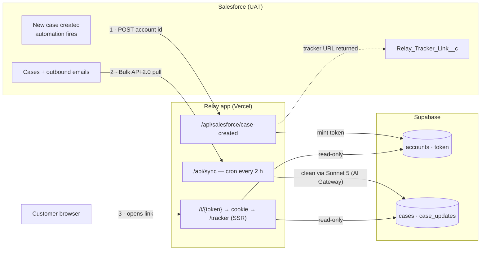

# Relay

Customer-facing support-ticket status pages for FieldPulse — replacing the per-customer Excel
trackers CS maintained by hand. Every Salesforce Account gets **one unguessable link**
(`/t/{token}`) showing its open tech-support tickets, status, and a cleaned "latest update" per
ticket. Public page, no login; the link itself is the credential, so it expires when idle and ops
can replace it (see "Link expiry" and "Rotating a customer link" below).

**Linear:** [Relay project](https://linear.app/fieldpulse/project/relay-e7e7451fa6f8) ·
**Architecture deep-dive:** `../docs/relay-backend-architecture.md`

## How it works — three independent flows



**1 · New case → link (instant, event push).** A Salesforce automation fires on case creation and
POSTs the account id to `/api/salesforce/case-created`. We upsert the account and mint a permanent
token (**one per account, not per case** — idempotent: the same account always gets the same link)
and return `{ trackerUrl }`. The SF automation writes that URL to `Relay_Tracker_Link__c` on the
Account. This is the **only** way an account enters Relay.

**2 · Data refresh (pull, every 2 h).** Vercel Cron calls `/api/sync`, which pulls case statuses +
each case's newest outbound email via **Salesforce Bulk API 2.0** (submit query job → poll →
download CSV — deliberately off the org's strained REST quota), runs each update through a Claude
Sonnet 5 clean + public-safety pass (via the Vercel AI Gateway), and upserts into Supabase. It only queries
cases for accounts already tracked.

**3 · Customer visit.** `/t/{token}` is an **entry point only**: a route handler validates the
token, stores it in an httpOnly `relay_tracker` cookie, and 302s to `/tracker`, which renders
server-side from **Supabase only** — Salesforce is never touched at page load, so pages are fast,
put zero load on the SF org, and survive an SF outage. The credential therefore never sits in the
address bar, browser history, client JS, or any analytics payload. Unknown token → the redirect
clears the cookie and `/tracker` fails closed with a branded 404 ("click the link again"); so does
`/tracker` opened directly or after the cookie is cleared. Two links opened in one browser: last
one wins.

**Link expiry.** A link stops opening once its account's `updated_at` is more than 60 days old
(`LINK_IDLE_DAYS` / `isLinkExpired` in `lib/tracker-session.ts`, checked on every token lookup).
The sync refreshes `updated_at` while the account has an open case or one closed in the last 30
days, so a link dies about **90 days after the account's last case closes**, and the same link
comes back at the first sync (every 2 h) after a new case opens. An expired link looks exactly
like an unknown one: the branded 404.

## Scope invariants — do not relitigate these

| Rule | Why |
|---|---|
| **Strict event-only. No backfill.** Accounts enter Relay only via the case-created endpoint; the sync is scoped to already-tracked accounts and can never create one. | Deliberate go-forward scope decision (not a gap). An unfiltered sync would mass-mint links for ~370 existing accounts. |
| **Relay is read-only against Salesforce.** The single SF write (`Relay_Tracker_Link__c`) is done by the SF automation, not by this app. | Keeps our integration surface minimal and the write path auditable on the SF side. |
| **Fail closed on content.** Cleaner error, model refusal, unparseable output, or sensitive content → generic fallback line. Raw email text never renders. | The page is public; this is the safety model (Claude safety pass, IAI-214). |
| **No client-side data access.** RLS enabled with zero policies; only the server-side service-role key can read/write. The browser gets finished HTML. | An unguessable link is the only credential — the data plane must not be reachable any other way. |

## Repo map

| Path | What it is |
|---|---|
| `app/t/[token]/route.ts` | Permanent-link entry point: validate token → httpOnly cookie → 302 `/tracker` (clears the cookie on a bad token) |
| `app/tracker/page.tsx` | The customer status page (SSR from the cookie, Supabase-only reads, 404 without a valid cookie) |
| `lib/tracker-session.ts` | Cookie name/attrs + token parsing (pure; covered by `test:lib`) |
| `app/api/sync/route.ts` | Sync trigger — GET (cron) + POST (manual, 10-min cooldown) |
| `app/api/salesforce/case-created/route.ts` | New-case webhook: upsert account, mint token, return link |
| `app/api/ops/rotate-link/route.ts` | Ops-only link replacement: new token for one account, returns the new link |
| `lib/salesforce.ts` | Bulk API 2.0 client: OAuth client-credentials, job → poll → CSV, RFC-4180 parser |
| `lib/sync.ts` | Sync orchestration: known-accounts scope, status mapping, clean, upsert |
| `lib/status.ts` | Raw `Case.Status` → customer chip mapping |
| `lib/update-cleaner.ts` | Sonnet 5 clean + safety pass (Vercel AI Gateway); exports the safe fallback line |
| `lib/data.ts` / `lib/supabase.ts` / `lib/env.ts` | Page data loader · service-role client · fail-fast env access |
| `lib/seed.ts` · `lib/fixtures/emails.ts` | Local seed data · cleaner golden-set fixtures |
| `scripts/test-lib.ts` · `scripts/eval-cleaner.ts` | Offline fixture tests · cleaner safety eval |
| `supabase/migrations/0001_init.sql` | Schema (apply via Supabase SQL editor or CLI) |
| `vercel.json` | Registers the 2-hourly cron on deploy |

## Data model

`accounts` (one per SF Account; `token` uuid = the public slug) → `cases` (status raw + chip,
open + closed-last-30d) → `case_updates` (one per case: raw email, cleaned text, `safety_flag`) ·
`sync_runs` (one row per sync for observability + audit).

Status chips (source: Saffi's mapping, validated against live data — all statuses that actually
occur on open tech cases are covered; anything unknown falls back to `in_progress`, never leaking
a raw internal status):

| Raw `Case.Status` | Chip |
|---|---|
| Waiting for Customer | `waiting_for_you` |
| New · Waiting for Support | `waiting_for_support` |
| In Progress · Hold · Monitoring · Waiting for CS · Waiting for Sync · Waiting on Engineering | `in_progress` |
| Closed · Cannot Reproduce · Rejected · Merged | `resolved` |
| *(anything else)* | `in_progress` |

Cases with `Status = 'Merged'` are excluded from the sync query itself (IAI-566) — a merged case
is a duplicate shell of its parent case, so it never reaches the tracker. The chip mapping above
remains as a safe default only.

## Environment variables

Names mirror `.env.example`. Locally: `.env.local` (gitignored). Deployed: Vercel project settings.

| Variable | Purpose |
|---|---|
| `SUPABASE_URL` / `SUPABASE_SERVICE_ROLE_KEY` | Read-store access (server-side only) |
| `SF_INSTANCE_URL` / `SF_CLIENT_ID` / `SF_CLIENT_SECRET` | Connected App OAuth client-credentials for Bulk API reads |
| `SALESFORCE_INTEGRATION_KEY` | Static bearer the SF case-create automation presents to us |
| `AI_GATEWAY_API_KEY` | Optional. Cleaner model calls (`anthropic/claude-sonnet-5`) go through the Vercel AI Gateway; on Vercel the project's OIDC token authenticates, so this is only for local/off-Vercel runs |
| `RELAY_SYNC_KEY` | Auth for the manual sync POST |
| `CRON_SECRET` | Vercel Cron sends `Authorization: Bearer $CRON_SECRET` on the GET — without it the scheduled sync 401s |
| `NEXT_PUBLIC_APP_URL` | Origin used to build tracker URLs (set to the real domain in prod) |
| `SLACK_ALERT_WEBHOOK_URL` | Slack incoming webhook — sync failures POST here (IAI-239). Unset = alerting no-ops |

## API

| Endpoint | Method | Auth | Behavior |
|---|---|---|---|
| `/api/sync` | GET | `Authorization: Bearer $CRON_SECRET` | Cron-triggered sync |
| `/api/sync` | POST | `x-relay-sync-key: $RELAY_SYNC_KEY` | Manual refresh; 429 if any run started < 10 min ago |
| `/api/salesforce/case-created` | POST | `Authorization: Bearer $SALESFORCE_INTEGRATION_KEY` | Body `{ "accountId": "001…", "accountName": "…" }` → `{ "trackerUrl": "https://…/t/<token>" }`. Idempotent per account. |
| `/api/health` | GET | `x-relay-sync-key: $RELAY_SYNC_KEY` | Sync health over `sync_runs` → `{ state, healthy, ageMinutes, lastRun }`. **200 healthy / 503 stale·stuck·error** — point an uptime monitor here. |
| `/api/ops/rotate-link` | POST | `x-relay-sync-key: $RELAY_SYNC_KEY` | Body `{ "sfAccountId": "001…" }` → `{ "trackerUrl": "https://…/t/<new token>" }`. Replaces the account's token; the old link stops working immediately. 404 if the account isn't tracked. See "Rotating a customer link". |

## Local development

```bash
npm install
cp .env.example .env.local   # fill in values
npm run dev
```

Degrades gracefully without creds: no Supabase → the page serves seed fixtures / unknown tokens
404; no Salesforce/Gateway credential → `/api/sync` errors cleanly and cleaner failures fall back safe.

```bash
npm run test:lib       # offline fixture tests (CSV parser, status mapping) — no creds needed
npm run eval:cleaner   # cleaner golden set — needs VERCEL_OIDC_TOKEN (`vercel env pull`) or AI_GATEWAY_API_KEY; safety gate must flag 5/5
npm run typecheck
```

## Usage analytics (Microsoft Clarity)

The customer page loads [Microsoft Clarity](https://clarity.microsoft.com/projects/view/z07u6fm8le)
**in production only** (`VERCEL_ENV === "production"`, decided server-side in `app/tracker/page.tsx`),
so previews and local dev never send anything. The project id is a public constant in
`app/tracker/analytics.ts`; there is no env var.

Why it is safe on a credential-bearing product: the page URL is `/tracker` (the token lives in an
httpOnly cookie, see `lib/tracker-session.ts`), sessions are tagged with Supabase `accounts.id`
(never the token), and customer content — account name, ticket subjects, update text — carries
`data-clarity-mask`, so recordings show *how the page is used*, not what the tickets say.

Session tags (filterable in Clarity): `account` (Supabase id), `entry` (`salesforce` when a CS
agent clicks through from the Account record, `webmail`, `direct`, `other`), `open_tickets`
(bucketed), `needs_reply`, and `internal=yes` when the link is opened with `?internal=1` (use this
for all our own testing — the "Customers" segment is `entry != salesforce AND internal != yes`).
Events: `refresh_clicked` → `refresh_done|fresh|busy|slow|error`, `resolved_expanded`,
`support_email_clicked`.

What Clarity can't tell you: how many of ALL links were ever opened. It counts browsers, not
accounts, and its export API covers 3 days. That number comes from first-party page views, below.

### First-party page views and `/api/stats`

Clarity counts browsers, not accounts, so the per-account number lives in our own Supabase:
`page_views` (migration `0004`), one row per real page load of `/tracker`. A browser beacon
(`app/tracker/ViewBeacon.tsx` → `POST /api/view`) records it, so email link scanners that follow the
link without running JavaScript don't count; reloads (including the Refresh button) don't count
either. The account comes only from the httpOnly session cookie. Stored per view: `account_id`,
`viewed_at`, coarse `entry` (same rule as the Clarity tag), coarse `device`
(`mobile`/`tablet`/`desktop`/`bot`/`unknown`, computed server-side), and `internal`. No IP, cookie id,
or raw user agent. Production only (`RELAY_RECORD_VIEWS=1` turns it on locally for testing).

Leadership numbers, from the `relay_usage_stats()` SQL function:

```bash
curl -s -H "x-relay-sync-key: $RELAY_SYNC_KEY" "https://mytickets.fieldpulse.com/api/stats?days=30"
```

Headline: `activeAccountsViewed / activeAccounts` (accounts with an open case whose page a customer
opened in the window). Also `accountsEverViewed` (since `trackingSince`), `returningAccounts` (customer
views on ≥2 distinct days), `customerViews`, `csViews`, `internalViews`, `deviceMix`. "Customer"
excludes internal test visits, CS click-throughs from Salesforce, and bots.

## Deploy & operations

**Vercel:** root directory `./`, Next.js preset, all env vars above set. The cron registers
automatically from `vercel.json` (every 2 h). `/api/sync` sets `maxDuration = 300` (requires Pro).

Manual sync (e.g. before CS shares a link):

```bash
curl -X POST https://<domain>/api/sync -H "x-relay-sync-key: $RELAY_SYNC_KEY"
```

**Observability (IAI-239).** Two failure modes, two mechanisms:
- **Explicit errors** (SF auth, Supabase, SOQL) → the sync posts a Slack alert to `SLACK_ALERT_WEBHOOK_URL`.
- **Silent timeouts** (function killed at `maxDuration`, row stuck `running`) → no code runs, so no
  alert; caught by `GET /api/health`, which returns **503** when stale/stuck/error. Point an uptime
  monitor at it (sending the `x-relay-sync-key` header) for hands-off detection.

Quick glance without the endpoint — last few runs straight from Supabase:

```sql
select started_at, finished_at, status, cases_upserted, error
from sync_runs order by started_at desc limit 5;
```

Known failure modes: OAuth 401 → Connected App client-credentials flow disabled or IP-restricted
(fix on the SF side); a malformed `sf_account_id` in `accounts` is skipped with a warning rather
than failing the Bulk query.

### Rotating a customer link

**When:** the link has reached someone it shouldn't (forwarded outside the customer's company,
posted somewhere public, sent to the wrong account), or the customer asks for a new one. Rotation
kills the old link, and every browser session opened from it, on their next request. Nothing else
about the account changes.

1. Copy the Account's 18-character Id from its Salesforce record.
2. Mint the replacement:

   ```bash
   curl -s -X POST https://mytickets.fieldpulse.com/api/ops/rotate-link \
     -H "x-relay-sync-key: $RELAY_SYNC_KEY" -H "Content-Type: application/json" \
     -d '{"sfAccountId":"001…"}'
   ```

   It returns `{ "trackerUrl": "https://…/t/<new token>" }`. A 404 means Relay doesn't track that
   account. Rotating also resets the idle clock, so the new link opens even if the old one had
   expired.
3. **Put the new URL into Salesforce by hand.** Relay can't write to Salesforce, and the
   case-create automation only ever fills a **blank** `Relay_Tracker_Link__c`: the Flow's entry
   criteria, the invocable Apex and the queueable each skip an Account whose field is already set.
   So until someone edits the field, the Account keeps showing the dead link, CS agents clicking
   through from Salesforce land on the 404, and new cases won't fix it. Ask someone with edit access
   on Account (Saffi or a Salesforce admin) to paste the new URL into **Relay Tracker Link**
   (Account Details → Account Information).
   - Alternative: clear the field instead. The next qualifying case on that account calls
     case-created, which returns the new URL, and the automation writes it. Until that case
     arrives the field stays blank, so pasting is better.
4. Send the customer the new link the usual way.

## Current state — 2026-07-13

Verified live against the UAT sandbox end-to-end: case-created → token → sync (Bulk API +
client-credentials confirmed) → page renders real cases with correct chips and Sonnet 5-cleaned
updates; second sync creates no new accounts (event-only holds). Still pending: Saffi to create
`Relay_Tracker_Link__c` (URL field on Account) and the case-create automation pointed at the
deployed endpoint; `NEXT_PUBLIC_APP_URL` → production domain; rotate the Supabase service-role +
OpenRouter keys before pilot; observability + pilot rollout (IAI-239).
